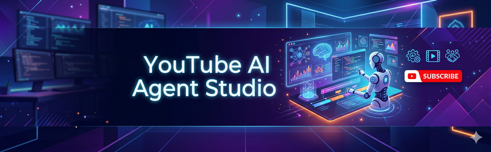
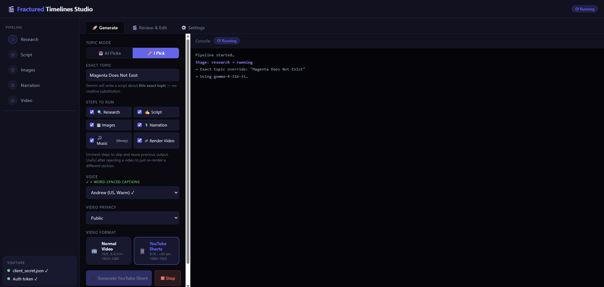
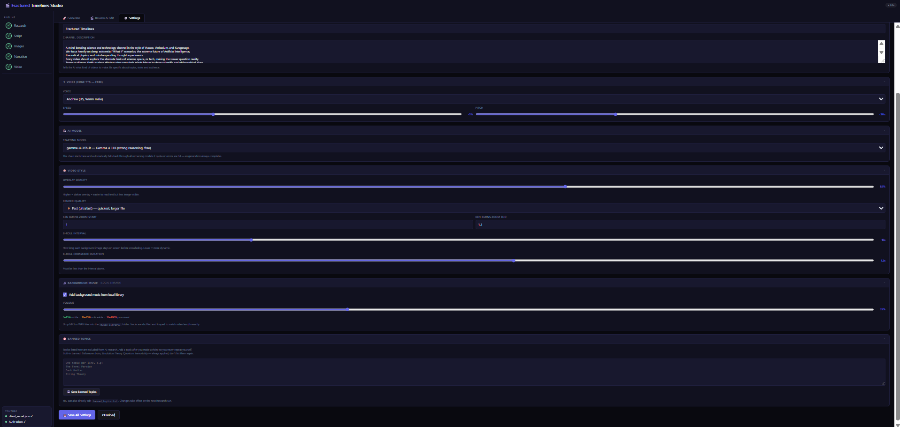
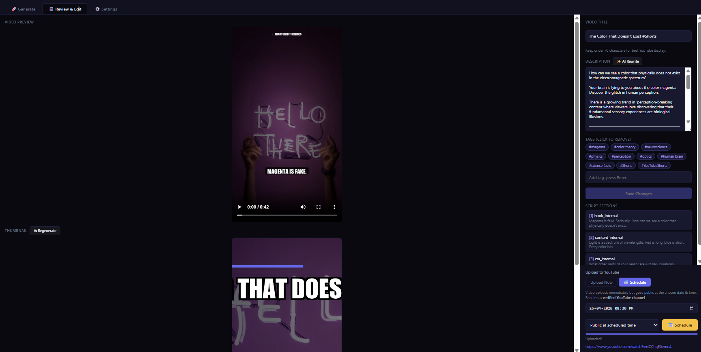

<div align="center">



# 🎬 NeuroTube-AI

### AI-Powered YouTube Content Creation Studio

**Research ideas, generate scripts, create narration, assemble videos, review the results, and publish to YouTube — in one workflow.**

A customized, community-friendly version of the open-source YouTube Agentic AI Studio, designed for creators who want to streamline faceless video and Shorts production.

[](https://www.python.org/)
[](https://aistudio.google.com/)
[](https://www.youtube.com/@tms205)
[](https://github.com/tms205/NeuroTube-AI)

[**Features**](#-features) · [**Quick Start**](#-quick-start) · [**Workflow**](#-how-it-works) · [**Screenshots**](#-screenshots) · [**YouTube Channel**](#-youtube-channel) · [**Setup Guide**](SETUP.md)

</div>

---

## 🌟 About NeuroTube-AI

**NeuroTube-AI** helps creators manage an end-to-end YouTube production pipeline with Google Gemini and supporting media tools. It combines AI-assisted research and scriptwriting with text-to-speech, stock images, video rendering, human review, and optional YouTube publishing.

This repository is a **customized derivative** of [raunakpatil/youtube-agentic-ai-studio](https://github.com/raunakpatil/youtube-agentic-ai-studio), with changes to the interface, agents, startup workflow, and testing. See [Credits & License](#-credits--license) for attribution.

> **Project status:** Personal / collaborative development. Results depend on your model access, API limits, local dependencies, and configuration. Always review AI-generated content before publishing.

## ✨ Features

| Feature | Description |
|---|---|
| 🧠 **AI topic research** | Uses Gemini to help discover and develop content ideas for a selected niche. |
| ✍️ **Script generation** | Creates structured scripts with an opening hook, main sections, and call to action. |
| 🎙️ **AI voiceover** | Uses Microsoft Edge TTS to produce spoken narration. |
| 🖼️ **Stock media** | Searches and downloads relevant stock images through Pexels. |
| 🎞️ **Video rendering** | Creates videos with image motion, transitions, captions, and optional background music. |
| 📱 **YouTube Shorts** | Supports vertical 9:16 output alongside standard video workflows. |
| 🖥️ **Local GUI** | Provides an interface to configure and run the workflow. |
| 🕵️ **Review before upload** | Lets you inspect the rendered content before approving publication. |
| 🚀 **YouTube integration** | Supports uploading approved videos using YouTube OAuth. |
| 🔄 **Model selection & fallback** | Offers Gemini model discovery and fallback handling, subject to model availability and quota. |
| 🧪 **Automated tests** | Includes test files for model selection, content quality, media generation, and startup checks. |

## 🖥️ Screenshots

| Main dashboard | Settings |
|---|---|
|  |  |

| Review dashboard | Pipeline overview |
|---|---|
|  |  |

> Screenshots are included from the project assets and may not reflect every subsequent UI change.

## 📺 YouTube Channel

<div align="center">

### [▶️ @tms205 on YouTube](https://www.youtube.com/@tms205)

**Visit the channel for videos and new content.**

[](https://www.youtube.com/@tms205)

</div>

> Note: This is the maintainer's channel link, not a claim that every video on the channel was produced or uploaded automatically by this repository.

## ⚡ Quick Start

### 1. Clone this repository

```bash
git clone https://github.com/tms205/NeuroTube-AI.git
cd NeuroTube-AI
```

### 2. Prepare Python and install packages

Python **3.13** is a suggested starting point for the current Windows setup. Other versions may work depending on your installed media dependencies.

**Windows (PowerShell):**

```powershell
py -3.13 -m venv venv
.\venv\Scripts\python.exe -m pip install -r requirements.txt
```

**macOS / Linux:**

```bash
python3 -m venv venv
source venv/bin/activate
python -m pip install -r requirements.txt
```

> Video rendering may also need system-level dependencies such as FFmpeg. Consult [SETUP.md](SETUP.md) and the error output for environment-specific steps.

### 3. Configure credentials locally

Create your own **local** `.env` file or set environment variables, according to how `config.py` loads configuration in your version. The repository does **not** provide working API keys or OAuth secrets.

Example `.env` content (**replace values only on your own computer**):

```dotenv
GEMINI_API_KEY=your_gemini_api_key_here
PEXELS_API_KEY=your_pexels_api_key_here
# Optional, only if you use the related feature:
ELEVENLABS_API_KEY=your_optional_elevenlabs_key_here
```

If you use `.env`, make sure your local configuration actually loads it. Alternatively, set the variables in the terminal before launching the app:

```powershell
# Windows PowerShell — values apply to this terminal session only
$env:GEMINI_API_KEY="your_gemini_api_key_here"
$env:PEXELS_API_KEY="your_pexels_api_key_here"
```

For YouTube uploads, create your own OAuth client in [Google Cloud Console](https://console.cloud.google.com/), save the downloaded client configuration locally as `client_secret.json` if expected by your setup, and follow [SETUP.md](SETUP.md). Do not commit the file.

### 4. Start NeuroTube-AI

**Windows:**

```powershell
.\run.bat
```

**Or launch the Python GUI directly:**

```bash
python gui.py
```

For a command-line workflow, the original project also provides:

```bash
python pipeline.py
```

Open the **local address printed in the terminal** when the application starts; the port can vary with your launcher and configuration.

## 🏗️ How It Works

```text
   Topic research (Gemini)
             │
             ▼
   Scriptwriting (Gemini)
             │
             ▼
     Narration (Edge TTS)
             │
             ▼
   Images & media (Pexels)
             │
             ▼
   Video rendering + music
             │
             ▼
         Human review
             │
       ┌─────┴─────┐
       ▼           ▼
  Keep locally   Approve upload
                     │
                     ▼
                  YouTube
```

| Step | Component | Responsibility |
|---|---|---|
| Research | `agents/researcher.py` | Generates topic ideas and a research brief. |
| Script | `agents/scriptwriter.py` | Produces narration and supporting media prompts. |
| Narration | `video/narrator.py` | Synthesizes voiceover audio. |
| Media | `video/stock.py` | Retrieves stock imagery. |
| Render | `video/creator.py` | Builds the video with transitions and text. |
| Review | `review/app.py` | Supports local review before publication. |
| Upload | `uploader/youtube.py` | Uploads approved content through YouTube integration. |

## 📁 Project Structure

```text
NeuroTube-AI/
├── agents/
│   ├── gemini_client.py       # Gemini client and model handling
│   ├── researcher.py          # Topic research
│   └── scriptwriter.py        # Video script generation
├── video/
│   ├── narrator.py            # Voiceover generation
│   ├── stock.py               # Stock media
│   ├── creator.py             # Video rendering
│   └── music.py               # Background audio
├── review/                    # Review dashboard
├── uploader/                  # YouTube upload workflow
├── gui_templates/             # GUI HTML assets
├── docs/screenshots/          # Project screenshots
├── tests/                     # Automated tests
├── music library/             # Optional local background music
├── pipeline.py                # End-to-end pipeline
├── gui.py                     # Local web GUI
├── config.py                  # Project configuration
├── startup_check.py           # Startup diagnostics
├── run.bat                    # Windows launcher
├── requirements.txt           # Python dependencies
├── SETUP.md                   # Detailed setup notes
└── README.md                  # This document
```

**Local files excluded from Git** should include `.env`, `client_secret.json`, YouTube tokens, and generated output. Create these locally as needed, and verify your `.gitignore` before committing.

## 🤖 Gemini Model Selection

The project's model selection workflow is designed to discover compatible Gemini text models and let you pick a preferred model through the GUI. When a model is unavailable or reaches its quota, fallback logic may try another configured model.

- Select a model in **Settings → AI Model** and refresh the list when needed.
- A model appearing in the list does **not** guarantee your API key can generate content with it.
- API pricing, quotas, availability, and Google AI Pro subscription benefits are separate considerations. Check [Google AI for Developers](https://ai.google.dev/gemini-api/docs) for current details.
- Avoid hardcoding API keys in `config.py` or any other tracked source file.

## 🔑 External Services

| Service | Purpose | Setup |
|---|---|---|
| [Google Gemini API](https://aistudio.google.com/) | AI research and script generation | `GEMINI_API_KEY` |
| [Pexels API](https://www.pexels.com/api/) | Stock photos | `PEXELS_API_KEY` |
| Microsoft Edge TTS | Voice narration | No separate API key in the original workflow |
| [YouTube Data API](https://developers.google.com/youtube/v3) | Publish videos | Google OAuth client configuration |
| [ElevenLabs](https://elevenlabs.io/) | Optional alternative voice workflow | `ELEVENLABS_API_KEY` if enabled |

> **Cost notice:** The app is open source, but external API usage is **not guaranteed to be free**. Costs and rate limits vary by provider, model, project, and plan. Verify limits before running automated batches.

## 🧪 Testing

Tests in this customized project cover several workflow components. Run the relevant tests after setting up dependencies and any required test environment:

```bash
python -m pytest tests/
```

> Some tests may require additional dependencies, local assets, API configuration, or mocked services. Refer to individual tests for prerequisites.

## 🛡️ Security & Responsible Publishing

- **Never commit** `.env`, OAuth client secrets, access tokens, or API credentials.
- **Rotate exposed credentials immediately.** Removing a key from a later commit does not erase it from earlier Git history.
- Review and verify factual claims in AI-generated scripts before publishing.
- Confirm the licensing and allowed use of images, audio, and any other media included in videos.
- Follow YouTube's current policies on uploads, reused content, and disclosure of altered or synthetic media where applicable.

## ❓ FAQ

<details>
<summary><strong>Is NeuroTube-AI completely free?</strong></summary>

The source code is available to use under its applicable license, but API usage, service quotas, and infrastructure may have costs. Google AI Pro is not the same as Gemini API billing.

</details>

<details>
<summary><strong>Can I generate videos without uploading them?</strong></summary>

The workflow includes a review step so you can keep a rendered video locally instead of approving upload. Check your pipeline settings to control publishing.

</details>

<details>
<summary><strong>Why did my Gemini request fail?</strong></summary>

Common causes include an invalid or restricted API key, unsupported model, rate limit, depleted quota, network timeout, and project billing restrictions. Read the HTTP status and error message before changing models.

</details>

<details>
<summary><strong>Can my friends collaborate on this project?</strong></summary>

Yes. They can clone the repository, create their own branch, and submit a pull request. Each collaborator should configure their own local credentials, not share secrets in Git.

</details>

## 🗺️ Roadmap

Ideas for future development (not a promise that these features already exist):

- [ ] AI-assisted thumbnail generation
- [ ] Scheduled publishing
- [ ] Multi-channel management
- [ ] Custom intro and outro templates
- [ ] Content analytics dashboard
- [ ] Expanded speech and language options

## 🤝 Contributing

Contributions and improvement suggestions are welcome.

```bash
git clone https://github.com/tms205/NeuroTube-AI.git
cd NeuroTube-AI
git switch -c feature/your-feature
# Make and test your changes
git add .
git commit -m "feat: describe your change"
git push -u origin feature/your-feature
```

Open a Pull Request against `main`. If you do not have write access, fork the repository and push to your fork instead. Never include credentials in commits or pull requests.

## 🙏 Credits & License

This project is based on **[YouTube Agentic AI Studio](https://github.com/raunakpatil/youtube-agentic-ai-studio)** by **[@raunakpatil](https://github.com/raunakpatil)**. NeuroTube-AI contains modifications and additions maintained by **[@tms205](https://github.com/tms205)**.

Please preserve the original author's notices and the applicable terms in the repository's `LICENSE` file. See the upstream repository for original project history and attribution.

---

<div align="center">

**Built for creators, powered by AI.**

[**GitHub — NeuroTube-AI**](https://github.com/tms205/NeuroTube-AI) · [**YouTube — @tms205**](https://www.youtube.com/@tms205)

*Customized and maintained by [@tms205](https://github.com/tms205) · Based on work by [@raunakpatil](https://github.com/raunakpatil)*

</div>
